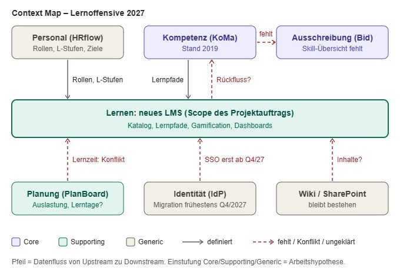

# Problem- und Scope-Definition – Lernoffensive 2027 (Nordwerk)
Vorbereitung auf Workshop am 24.11.2026

## A. Domänensicht (Domain-Driven Design)

### A1. Kernaussage
- Der Projektauftrag sieht **ein** Problem in **einer** Domäne: Lernangebot verstreut → Lösung: zentrales LMS mit Gamification.
- Das Geschäftsproblem liegt nach Datenlage in anderen Domänen (Hypothese):
  - **Ausschreibung & Nachweise**: 7 von 19 Verfahren verloren/abgewertet, keine Sicht, wer was kann
  - **Kompetenz & Zertifikate**: Kompetenzmatrix von 2019, keine Orientierung
- Die Voraussetzung für Nutzung, **Lernzeit & Kapazität**, wird im Auftrag als „geschaffen“ vorausgesetzt, ist laut Daten aber der größte Engpass (64 % „keine Zeit im Projekt“).
- Das LMS ist ein Baustein in einer unterstützenden Domäne, nicht die Lösung des Kernproblems.

### A2. Domänen und Subdomänen (Problem Space)
Einstufung Core / Supporting / Generic ist meine Arbeitshypothese und im Workshop zu prüfen.

| # | Domäne | Typ | Fachobjekte | Wer | Ist-Zustand / Problem | Im Projektauftrag? |
|---|---|---|---|---|---|---|
| 1 | **Ausschreibung & Nachweise** | Core | Verfahren, Nachweisforderung, Schlüsselpersonal, Angebot | Bid-Mgmt (K. Vogt), BL | 7/19 Verfahren 2025 verloren/abgewertet (BIM, PM); Skill-Abfrage per Mail/Teams, Tage vor Abgabe; Freelancer ca. 1,9 Mio. € | nur indirekt („Lücke bei Ausschreibungen“ über Zertifikate) |
| 2 | **Kompetenz & Zertifikate** | Core | Kompetenz, Kompetenzmatrix (KoMa), L-Stufe, Zertifikat, Skill-Profil | PE (J. Petersen) | KoMa Stand 2019, Update ohne Termin; nur 29 % wissen, was wichtig ist; keine Übersicht, wer was kann; Zertifizierungsbudget „kein Konsens“ | teilweise (Lernpfade je L-Stufe, Zertifikatspfade), Grundlage fehlt |
| 3 | **Lernen & Lernangebot** | Supporting | Kurs, Katalog, Lernpfad, Anmeldung, Lernhistorie, Content | PE, Fachbereiche (Content) | CampusOne 18 % aktiv (650 Lizenzen), Wiki/SharePoint parallel; 39 % „unübersichtlich“; Präsenz fast nur HH; CampusOne-Vertrag endet 30.06.2027 | **ja**, Kern des Auftrags (LMS) |
| 4 | **Lernzeit & Kapazität** | Supporting (Engpass) | Lerntag, Freistellung, Auslastung, Projektzuordnung, Zielvereinbarung | BL, TL, Controlling | Leitlinie 5 Lerntage (2022) vs. Ø 1,8 genutzt; 64 % keine Zeit; Auslastung 87 % (Ziel 85 %); „Bank-Zeiten“; BL-Ziele 2027 unverändert | **nein**, als „geschaffen“ vorausgesetzt |
| 5 | **Personalentwicklung & Bindung** | Supporting | PD-Gespräch, Entwicklungs-/Lernziel, Exit-Gespräch, Fluktuation | PE, BL | Fluktuation 14 %, Top-Grund Entwicklungsperspektive (41 %); Lernziele noch nicht im PD-Leitfaden; L-Stufen kommen im Gespräch nicht vor | nur als Wunsch („attraktiver Arbeitgeber“) |
| 6 | **Motivation & Steuerung** | Supporting | Punkte, Badge, Ranking, Dashboard, Weiterbildungsquote, Bericht | GF, BL/TL, PE | Ranking: 17 % Zustimmung / 52 % Ablehnung; Badges 41 % (als Funktion nur 15 %); Quote 34 % ohne Definition | **ja**, gesetzt (Gamification, Dashboards) |
| 7 | **Stammdaten, Identität, Wissensablage** | Generic | Mitarbeitende, Rolle, SSO, Wiki, SharePoint | IT-Services (T. Reimers) | HRflow führend (seit 01/2026), PersoNet nur Lohn; IdP-Migration frühestens Q4/2027; Wiki/SharePoint bleiben, keine Verschlagwortung | teilweise (SSO, PersoNet), teils überholt |
| – | *Querschnitt: Projekt-Governance* | – | Budget, Zeitplan, Business Case, Anbieterauswahl | GF, Controlling, PE | 250 T€ vs. 120 T€ freigegeben; Auswahl in 6 Wochen, Anforderungen noch offen | ja (Eckdaten), widersprüchlich |

**Build-vs-Buy-Sicht:** Generische und unterstützende Domänen (LMS, Identität) kauft man ein. Investieren sollte man in die Core-Domänen. Der Auftrag setzt das Budget aber auf den Teil, der am ehesten Standardware ist.

### A3. Bounded Contexts und Context Map (Solution Space)

| Beziehung (Upstream → Downstream) | Was fließt | Muster | Status / Problem |
|---|---|---|---|
| Personal (HRflow) → Lernen | Rollen, L-Stufen | Customer/Supplier | Auftrag nennt PersoNet, führend ist HRflow; Schnittstelle nicht beschrieben |
| Kompetenz → Lernen | Soll-Kompetenzen je L-Stufe → Lernpfade | Customer/Supplier | Lieferant veraltet (2019), kein Update eingeplant |
| Lernen → Kompetenz | abgeschlossene Kurse, Zertifikate | nicht definiert | im Auftrag nur „Lernhistorie“; Rückfluss ins Kompetenzprofil nicht beschrieben |
| Kompetenz → Ausschreibung | wer kann was (BIM, PM) | fehlt, heute ad hoc per Mail/Teams | nicht im Scope, aber Geschäftstreiber |
| Planung (PlanBoard) ↔ Lernen | Verfügbarkeit, Lerntage | Zielkonflikt | unklar, ob Lerntage im PlanBoard gebucht werden; Auslastungsziel 85 % |
| Identität (IdP) → Lernen | SSO | Conformist (Lernen folgt IdP) | Migration frühestens Q4/2027, Go-live Q3 2027 |
| Wiki/SharePoint → Lernen | Fachinhalte | ungeklärt | bleiben bestehen, keine einheitliche Verschlagwortung, Suche nicht eingeplant |

Zuordnung: Domäne 6 (Motivation & Steuerung) liegt im neuen LMS-Kontext (Dashboards, Ranking). Domäne 5 (PD-Gespräch) bleibt im Personal-Kontext.

### A4. Ubiquitous Language: Begriffe mit Unschärfe
| Begriff | Verwendung in den Unterlagen | Unschärfe |
|---|---|---|
| Weiterbildungsquote | Auftrag: 34 % → 70 %; Befragung: Ø 1,8 Lerntage | Definition und Quelle der 34 % fehlen |
| Lerntag | Leitlinie „5 Lerntage sind Arbeitszeit“; Befragung: Selbstauskunft inkl. E-Learnings, anteilig | Was zählt als Lerntag, wo wird er gebucht? |
| Nachweis / Zertifikat / Qualifikation | Auftraggeber: Nachweise für Schlüsselpersonal; Auftrag: Zertifikatspfade; FM: „Leute wollen Zertifikate“ | Gleiche Sache? Wer ist „benanntes Schlüsselpersonal“? |
| L-Stufe / Kompetenzmatrix | Lernpfade je L-Stufe; KoMa 2019; HRflow führend | Wie hängen L-Stufe und Kompetenzen zusammen? |
| Bank-Zeiten | Controlling: Qualifizierung „vorrangig in Bank-Zeiten“ | Annahme: Zeiten ohne Projektbelegung, bestätigen |
| Mitarbeitende / Projektpersonal | Auftrag: alle 1.150; IT: Lizenzbedarf 900 | Wer ist Zielgruppe? |
| Aktive Nutzung | CampusOne: 18 % in 90 Tagen | Welche Schwelle gilt für das neue LMS? |
| Kürzel | PE, PD, JF, BM, TL, KoMa im Protokoll | Rollen bestätigen |

### A5. Was die Domänensicht zeigt
1. **Scope-Lücke bei den Core-Domänen:** Nachweise (1) und Kompetenz (2) sind nicht im Auftrag. Ohne sie kann das LMS weder Lernpfade je L-Stufe liefern noch die Ausschreibungsverluste adressieren.
2. **Engpass Lernzeit (4):** Sie liegt außerhalb des Scopes, entscheidet aber über die Nutzung. Zielkonflikt: Auslastung 85 % und BL-Ziele bleiben, Lernzeit soll trotzdem entstehen.
3. **Lösung gegen Kultur (6 vs. 5):** Ranking und Einzel-Dashboards stoßen auf 52 % Ablehnung und haben Betriebsrats- und Datenschutz-Risiko. Gleichzeitig ist Entwicklungsperspektive der Top-Kündigungsgrund.
4. **Falsche oder überholte Annahmen in der generischen Domäne (7):** PersoNet statt HRflow, SSO vor IdP-Migration, Go-live nach CampusOne-Ende.
5. **Offene Schnittstellen:** Kompetenz → Ausschreibung und Lernen → Kompetenz sind nicht beschrieben.

---

## B. Quellenlage: Problem und Scope im Detail

### 1. Kurzfassung
- Nordwerk: Ingenieurgesellschaft, 1.150 Mitarbeitende, 5 Standorte (HH, HB, H, KI, HRO), ca. 70 % öffentliche Auftraggeber
- GF hat beschlossen: zentrales LMS + Gamification (Punkte, Badges, Ranking)
- Budget 250 T€, Anbieterauswahl in 6 Wochen (ca. Mitte Dez. 2026), Go-live Q3 2027
- Zielgröße: Weiterbildungsquote 34 % → 70 %
- Wir sind der externe Partner für Anforderungsaufnahme und Kriterien der Anbieterauswahl

### 2. Problem laut Projektauftrag (Sicht der GF)
- Lernangebot verstreut (CampusOne, Wiki, SharePoint), keine gemeinsame Suche/Übersicht
- CampusOne kaum genutzt (18 % aktiv in 90 Tagen bei 650 Lizenzen), Vertrag endet 30.06.2027
- Angebot optisch/didaktisch veraltet
- Auftraggeber prüfen Qualifikationen strenger → Nachteil in Ausschreibungen
- Annahme der GF: „Wenn das Angebot stimmt, kommt die Nutzung“
- Lösung ist gesetzt, „Grundsatzfragen sind geklärt“

### 3. Problem laut Datenlage (Arbeitshypothese)
Die Plattform löst nur einen Teil des Problems (Findbarkeit). Die Daten zeigen weitere Ursachen:

1. **Zeit** (Domäne 4)
   - 64 % „keine Zeit im Projekt“, nur 21 % haben ausreichend Zeit
   - Ø 1,8 genutzte Lerntage 2025 vs. 5 Lerntage laut Leitlinie (seit 2022)
   - Auslastung 87 % (Ziel 85 %), Controlling: Qualifizierung „vorrangig in Bank-Zeiten“
   - BL-Zielvereinbarungen 2027 bleiben unberührt → kein Anreiz für TL/BL, Zeit freizugeben
2. **Orientierung / Relevanz** (Domäne 2, 5)
   - 47 % „unklar, was relevant ist“, nur 29 % wissen, welche Kompetenzen wichtig sind
   - Kompetenzmatrix Stand 2019, Aktualisierung „wenn Kapazität da ist“
   - L-Stufen-Anforderungen kommen im PD-Gespräch nicht vor
3. **Nachweise / Zertifikate (eigentlicher Geschäftstreiber)** (Domäne 1, 2)
   - 2025: 7 von 19 öffentlichen Verfahren verloren/abgewertet, fehlende Nachweise (BIM, PM)
   - Nachweise zunehmend für benanntes Schlüsselpersonal gefordert
   - Freelancer ca. 1,9 Mio. € (überwiegend BIM-Modellierung)
   - Keine Übersicht, wer was kann („rumfragen“ per Mail/Teams, kurz vor Abgabe)
   - Zertifikatsförderung fehlt (22 % Hindernis), Zertifizierungsbudget „kein Konsens“
4. **Findbarkeit** (Domäne 3): 39 % „unübersichtlich“. Das ist das Problem, das das LMS adressiert; Wiki/SharePoint bleiben aber bestehen.
5. **Bindung** (Domäne 5)
   - Fluktuation 14 %, Top-Exit-Grund Entwicklungsperspektive (41 %)
   - Freitext: „wenn sich da nix tut bin ich nächstes jahr weg“

**Kernproblem (Hypothese):** Nordwerk kann Kompetenzen nicht gezielt aufbauen, sichtbar machen und gegenüber Auftraggebern nachweisen, weil Zeit, Orientierung, Anreize und Transparenz über vorhandene Skills fehlen. Das LMS ist Enabler, nicht Lösung.

### 4. Scope laut Projektauftrag
**In Scope**
- Zentrales LMS: Katalog, zentrale Suche, Anmeldung, Lernhistorie
- Gamification: Punkte, Badges, standortübergreifendes Ranking
- Lernpfade je L-Stufe (auf Basis Kompetenzmatrix), Zertifikatspfade
- Führungs-Dashboards: Fortschritt + Ranking pro Mitarbeitendem (TL/BL), Auswertung je Standort/Bereich (GF), Quotenbericht
- SSO, Rollen/L-Stufen automatisch übernehmen
- Anbieterauswahl, Einführung, Content-Aufbau
- VR-Training Baustellensicherheit als „Leuchtturm“ (Einordnung/Budget unklar)

**Nicht erwähnt / ungeklärt (Scope-Lücken)**
- Aktualisierung der Kompetenzmatrix (Voraussetzung für Lernpfade, PE ohne Kapazität)
- Lernzeit-Freistellung, Zielvereinbarungen, Rolle der Teamleitungen
- Zertifizierungsbudget
- Skill-/Nachweisübersicht für Ausschreibungen (treibt das Geschäftsproblem, fehlt im Auftrag)
- Wiki-/SharePoint-Inhalte, Suche, Verschlagwortung (laut Protokoll nicht eingeplant)
- Wünsche der Befragten: Mobile App (46 %), KI-Empfehlungen (33 %), Teams-Integration (31 %)
- Betriebsrat/Datenschutz bei individuellen Dashboards und Ranking
- Zielgruppen: Verwaltung/Zentrale Dienste, Werkstudierende, Teilzeit, Kiel/Rostock

### 5. Widersprüche in den Unterlagen
| Thema | Projektauftrag | Andere Quelle |
|---|---|---|
| Budget | 250 T€ | Controlling: 120 T€ freigegeben für 2027, Rest erst nach Business Case |
| Lernzeit | „Rahmenbedingungen geschaffen“ (5 Tage) | Ø 1,8 Tage, 21 % genug Zeit, Controlling: „Bank-Zeiten“ |
| Ranking | „Mitarbeitende wünschen sich spielerisches Lernen“ | Ranking 17 % Zustimmung / 52 % Ablehnung; Badges als Funktion nur 15 % |
| Stammdaten | Rollen/L-Stufen aus PersoNet | HRflow führend seit 01/2026, PersoNet nur Lohn |
| SSO / Go-live | SSO, Go-live Q3 2027 | IdP-Migration nicht vor Q4/2027 |
| Übergang | – | CampusOne endet 30.06.2027, Go-live Q3 → Lücke |
| Zielgruppe | „alle 1.150“ | Lizenzbedarf 900 (Projektpersonal) |
| Zeitplan | Auswahl in 6 Wochen, Kriterien erst im Workshop | Anforderungen noch nicht erhoben |
| Kompetenz-Lernpfade | Lernpfade je L-Stufe | KoMa Stand 2019, kein Update eingeplant |

### 6. Erfolgskriterien (Stand heute)
- Weiterbildungsquote 70 %: Definition und Messung unklar (Baseline 34 % ohne Quelle; Befragung: Ø 1,8 Tage Selbstauskunft)
- Messbare Wirkung auf Ausschreibungen (Nachweise) und Fluktuation fehlen als Ziel
- Umfragebasis: n = 612, Rücklauf 53 %, Headline 58 % = Absichtsbekundung, kein Gruppenausweis
